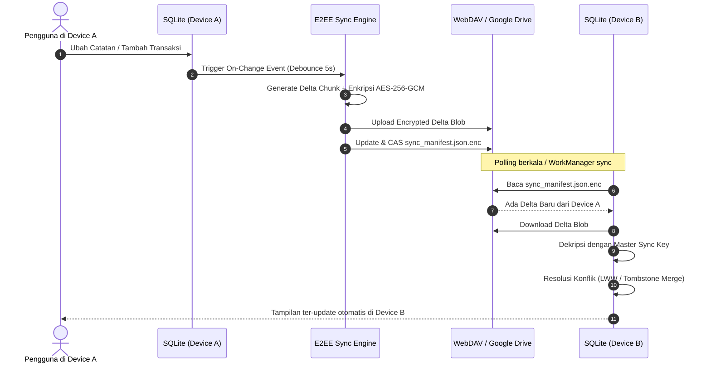
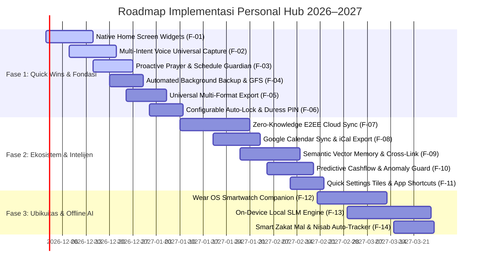

# Notulensi Sidang Dewan Inovasi & Proposal Komprehensif
## Roadmap Pengembangan Fitur Baru Personal Hub (2026–2027)

**Disusun Bersama oleh:**
- **Agent 4** (*Innovator B: Ecosystem, Sync & Feature Architect*)
- **Agent 3** (*Innovator A: AI & Smart Automation Specialist*)

**Platform Target:** Personal Hub Flutter (Android, iOS, Wear OS, Desktop & Web)  
**Tanggal Sidang:** 23 November 2026  
**Status Dokumen:** Blueprint Resmi & Roadmap Disahkan Dewan Inovasi  

---

## 1. Konteks Sidang & Ringkasan Eksekutif

Personal Hub telah berhasil membangun fondasi aplikasi produktivitas personal terintegrasi: menggabungkan **Catatan**, **Meeting**, **Tugas & Habit**, **Keuangan Harian**, **Jadwal Sholat & Kiblat**, **Brankas Password Terenkripsi**, serta **Asisten AI** berbasis `SamudraAiClient`. Seluruh data tersimpan secara lokal (*offline-first*) di dalam SQLite tanpa biaya server backend.

Namun, dalam evaluasi komprehensif Dewan Inovasi, ditemukan batasan fundamental yang membatasi potensi aplikasi:
1. **Silo Data & Ketergantungan Tunggal pada Perangkat**: Data terisolasi di satu perangkat fisik. Pergantian HP membutuhkan export/import backup manual `.phub`.
2. **Ketiadaan Integrasi Kalender Eksternal**: Jadwal rapat di Personal Hub tidak tersinkronisasi ke Google Calendar/iCal yang digunakan di tempat kerja.
3. **Ketergantungan Penuh pada Cloud AI**: Fitur AI parsing dan briefing mati total saat pengguna luring (*airplane mode*, sinyal lemah).
4. **Friksi Akses OS**: Pengguna harus membuka aplikasi secara penuh untuk tugas-tugas kecil (melihat sholat berikutnya, mencatat pengeluaran cepat, atau mencentang to-do).
5. **Reaktivitas Tanpa Antisipasi**: Asisten hanya menjawab saat ditanya; belum mampu mendeteksi tabrakan jadwal rapat dengan waktu ibadah sholat atau memprediksi cashflow bulan berjalan.

### Visi Transformasi
Mentransformasi Personal Hub dari *passive record-keeping utility* menjadi **Autonomous, Proactive & Ubiquitous Personal Life OS**, dengan tetap memegang teguh prinsip non-negosiasi: **100% Zero-Knowledge Privacy, Air-Gapped Password Vault, dan Zero Backend Operational Cost**.

```
┌────────────────────────────────────────────────────────────────────────────────────────┐
│                        PERSONAL HUB - FUTURE HORIZON ARCHITECTURE                      │
├────────────────────────────────────────────────────────────────────────────────────────┤
│                                                                                        │
│   SURFACES & HARDWARE:                                                                 │
│   Android/iOS App │ Home Widgets │ Quick Tiles │ Wear OS Smartwatch │ External Cal    │
│          │                 │              │              │                 │           │
│          ▼                 ▼              ▼              ▼                 ▼           │
│   INTELLIGENCE & AUTOMATION LAYER (Agent 3):                                           │
│   ├── Hybrid 3-Tier AI Router (On-Device SLM ↔ Samudra Cloud Fallback)                │
│   ├── Proactive Schedule Guardian (Meeting vs Prayer Collision & Buffer Nudges)        │
│   ├── Universal Multi-Intent Voice Copilot (1 Speech → Task + Expense + Note)          │
│   ├── Semantic Vector Memory & Local Knowledge Graph (sqlite-vec / ONNX)               │
│   └── Predictive Cashflow, Anomaly Guard & Auto-Zakat Calculator                       │
│          │                                                                             │
│          ▼                                                                             │
│   ECOSYSTEM, SYNC & DATA MOBILITY LAYER (Agent 4):                                     │
│   ├── Multi-Backend E2EE Sync Engine (WebDAV / Nextcloud / Google Drive AppData)       │
│   ├── Conflict-Free Delta Replication (CRDT / Vector Clocks & Tombstones)             │
│   ├── Bi-Directional Google Calendar API & iCal RFC 5545 Engine                        │
│   ├── Headless Background Backup (WorkManager + GFS Rotation)                          │
│   ├── Universal Multi-Format Exporter (PDF, Markdown with Frontmatter, CSV, Excel)     │
│   └── Hardened Biometrics Suite (Duress/Decoy PIN, Configurable Auto-Lock, FLAG_SECURE)│
│          │                                                                             │
│          ▼                                                                             │
│   SECURE STORAGE LAYER:                                                                │
│   SQLite v2 Database (Local-First) ───[AIR-GAP]─── AES-256-GCM Password Vault         │
│                                                                                        │
└────────────────────────────────────────────────────────────────────────────────────────┘
```

---

## 2. Prinsip Arsitektur Fundamental (Non-Negotiable Guarantees)

1. **Zero-Knowledge End-to-End Encryption (E2EE)**: Setiap sinkronisasi awan (WebDAV / Google Drive) dienkripsi di perangkat klien menggunakan kunci turunan passphrase pengguna (Argon2id / PBKDF2-HMAC-SHA256 + AES-256-GCM). Pihak ketiga penyedia storage hanya menyimpan ciphertext buram (*opaque blobs*).
2. **Air-Gapped Password Vault Isolation**: Data Brankas Kata Sandi (`vault_items`) diisolasi total. Tidak pernah dimasukkan ke dalam prompt AI, tidak diindeks ke dalam memori vektor semantic, tidak diekspos ke widget layar kunci, dan memiliki layer enkripsi ganda independen.
3. **Local-First & Offline Ubiquity**: Semua fungsi esensial (jadwal sholat, catatan, rapat, to-do, kalkulator keuangan, dan SLM on-device) harus berfungsi 100% tanpa internet. Konektivitas internet hanya bersifat akselerator sinkronisasi.
4. **Zero Backend Operational Cost**: Tidak ada server terpusat milik pengembang yang harus disewa atau di-maintain. Sinkronisasi multi-device memanfaatkan storage pribadi milik pengguna sendiri (Google Drive AppData gratis 15GB atau server WebDAV/Nextcloud pribadi).

---

## 3. Pilar Inovasi Ekosistem, Sinkronisasi & Integrasi Sistem (Domain Utama Agent 4)

---

### Inovasi 1: Multi-Device Sync & Zero-Knowledge Cloud Integration

#### 1. Deskripsi & Value Proposition
Memungkinkan sinkronisasi instan dan mulus antara smartphone Android, iPhone, tablet, hingga laptop/desktop pengguna tanpa perantara server terpusat. Pengguna dapat memilih penyimpanan awan mereka sendiri:
- **Google Drive (Restricted AppData Folder)**: Sangat ramah pengguna awam, cukup login akun Google yang sudah ada; file database tersembunyi dari Drive biasa sehingga aman dari terhapus tidak sengaja.
- **WebDAV / Nextcloud**: Pilihan utama pengguna pro, pehobi self-hosting, atau pengguna NAS lokal (Synology, QNAP, TrueNAS, Koofr) dengan kontrol data 100%.

#### 2. Arsitektur Teknis & Mekanisme Sinkronisasi
Sinkronisasi menggunakan pendekatan **Delta Replication + Conflict-Free Tombstoning**:
1. **Derivasi Kunci Sinkronisasi**: Kunci sinkronisasi diturunkan dari *Sync Passphrase* independen menggunakan `Argon2id` (atau PBKDF2-HMAC-SHA256, 150.000 iterasi) + salt unik acak 32-byte.
2. **Struktur File di Cloud Storage**:
   ```
   /PersonalHubSync/
   ├── sync_manifest.json.enc       # Berisi list active devices, latest epoch, & vector clock
   ├── devices/
   │   └── <device_uuid>.json.enc   # Heartbeat & device public state
   └── deltas/
       ├── 2026-11-23T10-00-00Z_<device_uuid>.delta.enc
       └── 2026-11-23T12-30-00Z_<device_uuid>.delta.enc
   ```
3. **Mekanisme Resolusi Konflik (Conflict Resolution)**:
   - Setiap tabel lokal (`notes`, `meetings`, `tasks`, `habits`, `finance_transactions`) ditambahkan field: `sync_version INTEGER`, `updated_at TEXT`, `device_id TEXT`, dan `is_deleted INTEGER DEFAULT 0` (soft tombstone).
   - Strategi default: **Last-Write-Wins (LWW)** berdasarkan timestamp UTC terverifikasi.
   - *Conflict Forking*: Jika terjadi benturan konkuren pada konten Catatan (`content`) atau Agenda Rapat, sistem tidak menimpa data, melainkan membuat duplikasi ramah pengguna: *"Judul Catatan (Konflik Sinkronisasi dari Tablet - 23 Nov)"*.



#### 3. Kelayakan Teknis & Dependensi
- **Tingkat Kelayakan**: Tinggi.
- **Library Flutter**: `http` (WebDAV via RFC 4918 methods), `googleapis` + `google_sign_in` (Google Drive AppData API), `cryptography` (AES-256-GCM), `uuid`.
- **Kompleksitas**: Sedang-Tinggi (penanganan offline, retry backoff, dan edge-cases konektivitas buruk).

---

### Inovasi 2: Integrasi Kalender Eksternal & Standar iCal RFC 5545

#### 1. Deskripsi & Value Proposition
Menghubungkan rapat dan jadwal penting di Personal Hub dengan kalender eksternal pengguna (Google Calendar, Outlook, Apple Calendar, Thunderbird):
- **Google Calendar 2-Way Sync**: Meeting yang dijadwalkan di Personal Hub otomatis muncul di Google Calendar kantor/pribadi lengkap dengan link rapat dan daftar peserta, dan sebaliknya perubahan jadwal di Google Calendar dapat ditarik ke aplikasi.
- **Export iCal (.ics)**: 1-tap bagikan jadwal ke WhatsApp atau email dalam format standar kalender dunia.
- **Local / WebDAV Calendar Feed**: Menyediakan URL kalender langganan (*subscription feed*) terenkripsi yang dapat dimasukkan ke aplikasi kalender desktop/ponsel bawaan.

#### 2. Desain Arsitektur & Skema
1. **Model Penautan Acara**:
   Setiap record pada tabel `meetings` menyimpan metadata sinkronisasi:
   ```sql
   ALTER TABLE meetings ADD COLUMN external_calendar_id TEXT DEFAULT NULL;
   ALTER TABLE meetings ADD COLUMN external_event_id TEXT DEFAULT NULL;
   ALTER TABLE meetings ADD COLUMN external_etag TEXT DEFAULT NULL;
   ALTER TABLE meetings ADD COLUMN sync_to_calendar INTEGER NOT NULL DEFAULT 0;
   ```
2. **Selective Privacy Filter**: Pengguna dapat memilih rapat mana yang ingin diekspor ke kalender publik/kantor vs rapat rahasia personal yang hanya disimpan lokal.
3. **iCal RFC 5545 Generator**: Generator lokal yang menyusun format VCALENDAR/VEVENT:
   ```text
   BEGIN:VCALENDAR
   VERSION:2.0
   PRODID:-//Personal Hub//Personal Productivity OS//ID
   CALSCALE:GREGORIAN
   BEGIN:VEVENT
   UID:meeting-937dd48e@personalhub.app
   DTSTAMP:20261123T100000Z
   DTSTART:20261124T030000Z
   DTEND:20261124T040000Z
   SUMMARY:Review Arsitektur Personal Hub
   DESCRIPTION:Agenda: Integrasi Cloud dan AI SLM
   LOCATION:Google Meet
   END:VEVENT
   END:VCALENDAR
   ```

#### 3. Kelayakan Teknis & Dependensi
- **Tingkat Kelayakan**: Sangat Tinggi.
- **Library Flutter**: `googleapis` (`CalendarApi`), `device_calendar` (opsional untuk kalender bawaan OS lokal), `intl`.
- **Kompleksitas**: Sedang.

---

### Inovasi 3: Backup Otomatis di Latar Belakang & Portabilitas Data Multi-Format

#### 1. Deskripsi & Value Proposition
Menghilangkan risiko kehilangan data fatal (*device dropped in water, stolen, or corrupted*) dengan sistem proteksi pasif:
- **Automated Background Backup**: Backup terenkripsi dibuat secara otomatis setiap malam tanpa mengganggu pengguna saat perangkat sedang dicas dan terhubung Wi-Fi.
- **Grandfather-Father-Son (GFS) Rotation**: Mengelola siklus retensi snapshot secara otomatis (menyimpan 7 snapshot harian, 4 snapshot mingguan, 3 snapshot bulanan) agar memori penyimpanan tidak membengkak.
- **Universal Multi-Format Export**:
  - **Catatan**: Ekspor format Markdown (`.md`) bersih dengan metadata YAML frontmatter, atau dokumen cetak PDF cantik via layouting visual.
  - **Keuangan**: Ekspor tabel transaksi ke format CSV standar RFC 4180 atau file Excel (`.xlsx`) lengkap dengan filter tanggal dan kategori, mempermudah pelaporan SPT pajak tahunan atau pembukuan Excel.
  - **Vault Portability**: Ekspor format terenkripsi yang kompatibel dengan Bitwarden / 1Password JSON standar industri, disertai proteksi Master PIN dan peringatan keamanan ketat.

#### 2. Desain Arsitektur & Alur Background Worker
1. **Background Scheduler**: Memanfaatkan `workmanager` (Android WorkManager API & iOS BGTaskScheduler) dengan *Constraints*:
   - `NetworkType.unmetered` (Hanya Wi-Fi)
   - `RequiresCharging: true`
   - `RequiresBatteryNotLow: true`
2. **Alur Eksekusi**:
   Worker membaca SQLite -> memanggil `BackupService.exportSnapshotJson()` -> mengenkripsi dengan `BackupCryptoService` (AES-256-GCM) menggunakan passphrase terdaftar di Keystore -> menyimpan file snapshot ke folder internal yang aman atau mengunggah ke remote storage (WebDAV/GDrive) -> menjalankan rutinitas rotasi GFS menghapus snapshot kadaluarsa.

```
┌──────────────────────────────────────────────────────────────┐
│                  RETENSI ROTASI BACKUP GFS                   │
├──────────────────────────────────────────────────────────────┤
│  Daily (Harian):     [H-1] [H-2] [H-3] [H-4] [H-5] [H-6] [H-7]│
│  Weekly (Mingguan):  [W-1] [W-2] [W-3] [W-4]                 │
│  Monthly (Bulanan):  [M-1] [M-2] [M-3]                       │
│  => Total penyimpanan terkendali (~5MB - 15MB total)        │
└──────────────────────────────────────────────────────────────┘
```

#### 3. Kelayakan Teknis & Dependensi
- **Tingkat Kelayakan**: Tinggi.
- **Library Flutter**: `workmanager`, `csv`, `pdf`, `printing`, `excel`, `path_provider`.
- **Kompleksitas**: Sedang.

---

### Inovasi 4: Integrasi Sistem Operasi & Hardware (Widgets, Tiles, Wear OS & Security)

#### 1. Native Home Screen Widgets (Android & iOS)
Mengintegrasikan widget interaktif langsung pada layar utama smartphone pengguna via plugin `home_widget`:
1. **Widget Jadwal Sholat & Hitung Mundur (2x2 / 4x1)**:
   - Menampilkan waktu sholat berikutnya secara live (misal: *"Ashar 15:15 - dalam 24 menit"*), progres visual waktu berjalan, dan jadwal 5 waktu sholat.
   - Menggunakan snapshot data terkomputasi lokal tanpa perlu membuka aplikasi.
2. **Widget Daily Briefing & Agenda Rapat (4x2)**:
   - Menampilkan tanggal Masehi & Hijriah, ringkasan rapat terdekat hari ini (judul, jam, lokasi), serta sisa tugas aktif prioritas tinggi.
3. **Widget Quick Action Bar (4x1)**:
   - Tombol instan 1-tap: `[+ Catatan]` `[+ Tugas]` `[+ Pengeluaran]` `[🎙️ Voice AI]`.

#### 2. Quick Settings Tiles & Dynamic App Shortcuts
- **Android Quick Settings Tile**:
  - *Tile 1: "Voice Quick-Capture"*: Menarik tirai notifikasi dan menekan tile langsung membuka dialog overlay mikrofon untuk mencatat apa saja via suara tanpa harus mencari ikon aplikasi.
  - *Tile 2: "Jadwal Sholat"*: Menampilkan teks waktu sholat berikutnya pada subtitle tile dan 1-tap langsung membuka kiblat kompas.
- **Dynamic App Launcher Shortcuts (Tekan & Tahan Ikon Aplikasi)**:
  - *"Catat Pengeluaran Cepat"*
  - *"Tambah Tugas Baru"*
  - *"Buka Brankas Sandi"*

#### 3. Wear OS / Smartwatch Companion & Rich Interactive Notifications
- **Wear OS Tile & Watch Face Complications**:
  - Komplikasi tampilan jam tangan pintar untuk menampilkan icon sholat berikutnya + countdown menit.
  - Tile sederhana untuk melihat 3 to-do teratas hari ini dengan fungsi centang langsung dari pergelangan tangan.
- **Interactive Rich Notifications**:
  - Notifikasi Adzan dengan aksi langsung: `[Sudah Sholat]` (otomatis centang habit Sholat) atau `[Ingatkan 10 Menit Lagi]`.
  - Notifikasi Rapat dengan tombol `[Gabung Rapat]` (langsung buka URL Zoom/Google Meet) dan `[Catat Notulensi]`.

#### 4. Advanced Biometric Suite & Anti-Coercion Security
1. **Duress PIN (PIN Palsu / Umpan Anti-Pemaksaan)**:
   - Fitur keamanan kelas tinggi: Pengguna dapat mengonfigurasi PIN kedua yang dinamakan **Duress PIN**.
   - Jika pengguna dipaksa oleh pihak ketiga di bawah ancaman untuk membuka Brankas Password, pengguna dapat memasukkan Duress PIN ini.
   - Brankas akan terbuka secara normal tanpa pesan eror mencurigakan, tetapi menampilkan **Decoy Vault** (berisi beberapa akun palsu buatan yang tidak berbahaya). Kredensial asli tetap terenkripsi dan tersembunyi total.
2. **Customizable Auto-Lock Timeout**:
   - Opsi fleksibel di Pengaturan: `Kunci Seketika`, `30 Detik`, `1 Menit`, `5 Menit`, `15 Menit`.
   - Menggunakan penghitung waktu berbasis selisih timestamp (`DateTime.now().difference(_lastBackgroundTime)`) sehingga tidak mengunci jika pengguna hanya berpindah aplikasi sebentar untuk menyalin kode OTP.
3. **FLAG_SECURE Anti-Snoop Guard**:
   - Opsi proteksi privasi untuk memblokir screenshot layar dan memburamkan tampilan aplikasi di menu *Recent Apps / Multitasking Overview*.

---

## 4. Pilar Inovasi AI & Smart Automation (Sintesis Proposal Agent 3)

Berdasarkan proposal yang dirumuskan oleh Agent 3 (*Innovator A*) dalam `ai_smart_automation_proposal.md`, berikut adalah 5 pilar kecerdasan buatan yang disintesiskan ke dalam roadmap terpadu:

---

### Inovasi 5: Hybrid 3-Tier Edge/Cloud SLM Router (100% Offline Intelligence)
- **Konsep**: Mengakhiri ketergantungan 100% pada jaringan internet dengan mengadopsi Small Language Model (SLM) lokal yang sangat ringan (`SmolLM-135M` atau `Qwen2.5-0.5B-INT4` footprint RAM ~150MB–250MB) yang berjalan langsung di CPU/NPU ponsel via MediaPipe/FFI.
- **Alur Kerja Router**:
  - **Tier 1 (On-Device SLM)**: Menangani tugas struktural berkecepatan tinggi (parsing transaksi keuangan, klasifikasi teks, ekstraksi to-do sederhana, peringkasan catatan pendek) secara instan (250ms), zero data cost, dan 100% privat.
  - **Tier 2 (Samudra AI Cloud Free)**: `deepseek-v4.1-flash:free` untuk penalaran rumit dan percakapan panjang saat ponsel terkoneksi internet.
  - **Tier 3 (Samudra AI Cloud Fallback)**: `deepseek-v4.1-flash` otomatis jika Tier 2 terkena rate-limit / kuota habis.
- **Sinergi Ekosistem**: Memungkinkan wearable smartwatch dan tablet tetap pintar meskipun sedang berada di luar jangkauan sinyal internet.

---

### Inovasi 6: Semantic Vector Memory & Local Knowledge Graph
- **Konsep**: Menggantikan pencarian teks murni `contains(q)` dengan memori vektor semantik di sisi klien (`sqlite-vec` atau model embedding lokal `bge-micro-v2` 384 dimensi, ukuran model ~18MB).
- **Kapabilitas**:
  - **Pencarian Semantik Multi-Domain**: Mencari *"persiapan liburan jogja"* otomatis menampilkan catatan daftar hotel, tugas beli tiket kereta, dan transaksi pembayaran DP sewa mobil.
  - **Auto Bi-Directional Linking**: Saat pengguna membuka form Meeting klien tertentu, sistem otomatis menampilkan catatan masa lalu yang menyebutkan nama klien tersebut tanpa perlu tagging manual.
- **Sinergi Ekosistem**: Vector embedding murni dihitung lokal; sinkronisasi E2EE hanya menyinkronkan data inti untuk menghemat kuota internet dan daya komputasi awan.

---

### Inovasi 7: Proactive Schedule Guardian & Conflict Engine
- **Konsep**: Mengubah peran AI dari asisten pasif menjadi penjaga jadwal otonom yang proaktif.
- **Fitur Kunci**:
  - **Prayer Collision Warning**: Mendeteksi jika rapat yang dijadwalkan bertabrakan dengan waktu sholat fardhu (misal: Rapat jam 15:00 bertabrakan dengan Ashar 15:15) dan memberikan rekomendasi penyesuaian jadwal 1-tap.
  - **Travel Buffer Estimation**: Memperingatkan pengguna jika ada dua rapat berturut-turut di lokasi fisik berbeda tanpa jeda waktu tempuh yang realistis.
  - **Audio Daily Briefing (TTS)**: Ringkasan audio pagi yang dapat didengarkan tanpa melihat layar ponsel saat mengemudi atau sarapan.
- **Sinergi Ekosistem**: Terintegrasi dua arah dengan Google Calendar dan mendorong peringatan proaktif langsung ke layar smartwatch Wear OS.

---

### Inovasi 8: Universal Omnipresent Multi-Intent Voice Copilot
- **Konsep**: Memperluas fitur perekam suara yang semula hanya ada di form rapat menjadi sistem *quick-capture* suara universal yang dapat diakses dari widget atau tombol home.
- **Mekanisme Atomik**:
  - Pengguna berbicara bebas: *"Tadi makan siang soto 35 ribu, terus tolong ingatkan besok jam 9 pagi follow-up proposal ke Pak Budi, sama catat ide konten: tren AI lokal."*
  - Parser AI memecah pesan ini secara atomik menjadi 3 aksi sekaligus:
    1. Transaksi Keuangan: Pengeluaran Makanan Rp 35.000.
    2. Tugas: "Follow-up proposal ke Pak Budi" (Tenggat: Besok 09:00, Prioritas: Tinggi).
    3. Catatan: "Ide Konten: Tren AI Lokal" (Tag: `#ide`, `#ai`).
  - Menampilkan *Interactive Staging Sheet* untuk konfirmasi 1-tap.
- **Sinergi Ekosistem**: Dapat dipicu langsung dari Android Quick Settings Tile dan Home Screen Widget.

---

### Inovasi 9: Predictive Cashflow, Anomaly Guard & Smart Zakat Engine
- **Konsep**: Meningkatkan modul keuangan dari sekadar buku kas historis menjadi *financial copilot* masa depan.
- **Fitur Kunci**:
  - **Deteksi Tagihan Berulang**: Mengenali pola langganan rutin (listrik, internet, BPJS, sewa) dan memproyeksikannya ke kalender pengeluaran.
  - **Proyeksi Burn-Rate**: Memprediksi sisa saldo di akhir bulan berdasarkan kecepatan belanja harian pengguna.
  - **Anomaly Alert**: Memberi peringatan jika pengeluaran kategori tertentu melompat drastis di atas deviasi normal.
  - **Kalkulator Zakat Mal & Nisab Otomatis**: Memantau aset lancar pengguna terhadap nilai nisab emas riil (85 gram) dan menghitung kewajiban 2.5% secara otomatis jika telah memenuhi haul.
- **Sinergi Ekosistem**: Terintegrasi dengan fitur Export Laporan Keuangan Bulanan ke PDF/Excel dan sinkronisasi E2EE multi-device.

---

## 5. Matriks Evaluasi & Prioritas Fitur (Roadmap P1 / P2 / P3)

Dewan Inovasi menetapkan pembagian prioritas berdasarkan perpaduan antara **User Value**, **Kompleksitas Implementasi**, dan **Kesiapan Fondasi Arsitektur**:

| ID | Nama Fitur | Kategori | Value Proposition | Kelayakan Teknis | Arsitektur & Dependensi Utama | Prioritas |
| :---: | :--- | :---: | :--- | :---: | :--- | :---: |
| **F-01** | **Native Home Screen Widgets** | Sistem & UI | Akses cepat jadwal sholat, to-do, dan quick action tanpa buka aplikasi | **Tinggi** | `home_widget`, AppWidgetProvider, iOS WidgetKit | **P1** |
| **F-02** | **Multi-Intent Voice Quick-Capture** | AI & Voice | 1 kali bicara bebas otomatis diurai jadi Tugas + Pengeluaran + Catatan | **Tinggi** | `speech_to_text`, `SamudraAiClient`, Staging Sheet | **P1** |
| **F-03** | **Proactive Schedule & Prayer Guardian** | AI & Waktu | Mencegah tabrakan rapat dengan waktu sholat dan waktu buffer perjalanan | **Tinggi** | `adhan`, `meetings_repository`, Notification Engine | **P1** |
| **F-04** | **Automated Background Backup & GFS** | Proteksi Data | Perlindungan data otomatis saat HP dicas + rotasi backup berkala | **Tinggi** | `workmanager`, `BackupService`, `BackupCryptoService` | **P1** |
| **F-05** | **Universal Multi-Format Export** | Portabilitas | Ekspor Catatan ke Markdown/PDF & Keuangan ke CSV/Excel untuk laporan | **Tinggi** | `csv`, `pdf`, `printing`, `excel`, `file_export_helper` | **P1** |
| **F-06** | **Configurable Auto-Lock & Duress PIN** | Keamanan | Menghindari frustrasi lock seketika + perlindungan anti-pemaksaan | **Tinggi** | `VaultLockController`, `SecureConfigStore`, salt hashing | **P1** |
| **F-07** | **Zero-Knowledge Multi-Device Sync** | Sinkronisasi | Sinkronisasi E2EE antar perangkat via Google Drive AppData & WebDAV | **Sedang** | `googleapis`, HTTP WebDAV, `cryptography` AES-256-GCM | **P2** |
| **F-08** | **Google Calendar 2-Way Sync & iCal** | Kalender | Sinkronisasi agenda rapat Personal Hub dengan kalender kantor/pribadi | **Tinggi** | `googleapis` (CalendarApi), RFC 5545 iCal generator | **P2** |
| **F-09** | **Semantic Vector Memory & Search** | AI & Search | Pencarian makna konteks cerdas lintas catatan, tugas, dan keuangan | **Sedang** | Model ONNX `bge-micro-v2`, `sqlite-vec` / BLOB vector table | **P2** |
| **F-10** | **Predictive Cashflow & Recurring Bills** | Finansial | Proyeksi sisa saldo akhir bulan & deteksi otomatis langganan rutin | **Tinggi** | Time-series heuristic analyzer, `finance_repository` | **P2** |
| **F-11** | **Android Quick Settings Tiles & Shortcuts** | Sistem OS | Pintasan instan catat pengeluaran & voice memo dari tirai notifikasi | **Tinggi** | Android `TileService`, Flutter MethodChannel | **P2** |
| **F-12** | **Wear OS Smartwatch Companion App** | Wearable | Notifikasi interaktif, countdown sholat & to-do check di pergelangan | **Sedang** | Wear OS Flutter Runner, Watch Face Complication | **P3** |
| **F-13** | **On-Device Local SLM Engine** | AI Offline | Ekstraksi AI & percakapan 100% offline tanpa biaya kuota dan internet | **Sedang** | `SmolLM-135M` / `Qwen-0.5B` via MediaPipe / FFI runtime | **P3** |
| **F-14** | **Smart Zakat Mal & Nisab Auto-Estimator** | Finansial | Perhitungan zakat otomatis berbasis harga emas riil & haul aset | **Tinggi** | Gold price scraper/API, Islamic jurisprudence logic | **P3** |

---

## 6. Blueprint Rencana Eksekusi Bertahap (Phased Roadmap)



### Fase 1: Immediate High-Impact Quick Wins (Bulan ke-1 / Sprint 1 & 2)
*Tujuan: Memaksimalkan nilai guna harian pengguna langsung di ponsel yang sudah ada.*
- **Widgets Layar Utama**: Jadwal sholat live & to-do briefing.
- **Perekam Suara Multi-Intent**: 1 kali rekam suara langsung menghasilkan tugas, catatan, dan pengeluaran.
- **Penjaga Jadwal Proaktif**: Peringatan tabrakan meeting dengan waktu sholat dan estimasi jeda perjalanan.
- **Backup Otomatis Latar Belakang**: Backup malam hari saat ponsel dicas dengan rotasi retensi GFS.
- **Multi-Format Export**: Cetak catatan ke PDF/Markdown dan ekspor keuangan ke CSV/Excel.
- **Keamanan Lanjutan**: Auto-lock timeout fleksibel (30s, 1m, 5m) dan perlindungan Duress PIN untuk Brankas.

### Fase 2: Connected Ecosystem & Semantic Intelligence (Bulan ke-2 / Sprint 3 & 4)
*Tujuan: Membuka isolasi data dan menyatukan konteks hidup pengguna lintas perangkat.*
- **E2EE Cloud Sync**: Sinkronisasi multi-device tanpa biaya server via Google Drive AppData & WebDAV/Nextcloud pribadi.
- **Integrasi Google Calendar & iCal**: Sinkronisasi dua arah meeting dan tugas berjadwal.
- **Pencarian Semantik & Cross-Linking**: Mengintegrasikan embedding lokal untuk menemukan hubungan catatan-rapat-keuangan.
- **Prediksi Keuangan**: Peringatan burn-rate dan deteksi tagihan berulang bulanan.
- **Android Quick Tiles**: Shortcut instan di tirai notifikasi.

### Fase 3: Ubiquity & Zero-Cloud Edge AI (Bulan ke-3 / Sprint 5 & 6)
*Tujuan: Pengalaman tanpa hambatan di pergelangan tangan dan kecerdasan 100% lokal.*
- **Wear OS Smartwatch Companion**: Aplikasi pendamping jam tangan pintar dan watch face complications.
- **On-Device Local SLM**: Menjalankan model SLM 135M/0.5B langsung di chipset HP untuk kecerdasan zero-internet.
- **Automated Zakat Mal & Nisab Tracker**: Pelacak nisab emas terintegrasi fiqih zakat.

---

## 7. Cetak Biru Skema Database (Migrasi SQLite v2)

Untuk mendukung seluruh fungsionalitas di atas, `AppDatabase` akan dinaikkan dari `version = 1` ke `version = 2` dengan DDL migrasi non-destruktif:

```sql
-- ========================================================
-- 1. TABEL SINKRONISASI & METADATA PERANGKAT (E2EE SYNC)
-- ========================================================
CREATE TABLE sync_devices (
  device_id TEXT PRIMARY KEY,
  device_name TEXT NOT NULL,
  platform TEXT NOT NULL,
  last_synced_at TEXT NOT NULL,
  is_active INTEGER NOT NULL DEFAULT 1
);

CREATE TABLE sync_tombstones (
  entity_id TEXT PRIMARY KEY,
  entity_type TEXT NOT NULL, -- 'notes', 'meetings', 'tasks', 'habits', 'finance'
  deleted_at TEXT NOT NULL,
  device_id TEXT NOT NULL
);

-- Penambahan field sinkronisasi pada tabel-tabel inti
ALTER TABLE notes ADD COLUMN sync_version INTEGER NOT NULL DEFAULT 1;
ALTER TABLE notes ADD COLUMN is_deleted INTEGER NOT NULL DEFAULT 0;

ALTER TABLE meetings ADD COLUMN sync_version INTEGER NOT NULL DEFAULT 1;
ALTER TABLE meetings ADD COLUMN is_deleted INTEGER NOT NULL DEFAULT 0;
ALTER TABLE meetings ADD COLUMN external_calendar_id TEXT DEFAULT NULL;
ALTER TABLE meetings ADD COLUMN external_event_id TEXT DEFAULT NULL;
ALTER TABLE meetings ADD COLUMN sync_to_calendar INTEGER NOT NULL DEFAULT 0;

ALTER TABLE tasks ADD COLUMN sync_version INTEGER NOT NULL DEFAULT 1;
ALTER TABLE tasks ADD COLUMN is_deleted INTEGER NOT NULL DEFAULT 0;

ALTER TABLE habits ADD COLUMN sync_version INTEGER NOT NULL DEFAULT 1;
ALTER TABLE habits ADD COLUMN is_deleted INTEGER NOT NULL DEFAULT 0;

ALTER TABLE finance_transactions ADD COLUMN sync_version INTEGER NOT NULL DEFAULT 1;
ALTER TABLE finance_transactions ADD COLUMN is_deleted INTEGER NOT NULL DEFAULT 0;

-- ========================================================
-- 2. TABEL MEMORI VEKTOR SEMANTIK & KNOWLEDGE GRAPH
-- ========================================================
CREATE TABLE document_embeddings (
  id TEXT PRIMARY KEY,
  entity_id TEXT NOT NULL,
  entity_type TEXT NOT NULL, -- 'note', 'meeting', 'task', 'finance'
  content_hash TEXT NOT NULL,
  embedding BLOB NOT NULL, -- 384 dimensions x Float32 (1536 bytes)
  updated_at TEXT NOT NULL
);
CREATE INDEX idx_embeddings_entity ON document_embeddings(entity_type, entity_id);

CREATE TABLE entity_links (
  id TEXT PRIMARY KEY,
  source_type TEXT NOT NULL,
  source_id TEXT NOT NULL,
  target_type TEXT NOT NULL,
  target_id TEXT NOT NULL,
  relation_type TEXT NOT NULL, -- 'mentions', 'generated_from', 'finance_for'
  confidence REAL NOT NULL DEFAULT 1.0,
  created_at TEXT NOT NULL
);
CREATE INDEX idx_links_source ON entity_links(source_type, source_id);
CREATE INDEX idx_links_target ON entity_links(target_type, target_id);

-- ========================================================
-- 3. TABEL ATURAN KEUANGAN BERULANG (PREDICTIVE FINANCE)
-- ========================================================
CREATE TABLE recurring_finance_rules (
  id TEXT PRIMARY KEY,
  category TEXT NOT NULL,
  estimated_amount INTEGER NOT NULL,
  recurrence_day INTEGER NOT NULL, -- Tanggal jatuh tempo (1-31)
  note TEXT NOT NULL DEFAULT '',
  confidence REAL NOT NULL DEFAULT 0.8,
  is_active INTEGER NOT NULL DEFAULT 1,
  created_at TEXT NOT NULL
);
```

---

## 8. Analisis Risiko & Mitigasi Keamanan

| Skenario Risiko / Ancaman | Dampak | Strategi Mitigasi Teruji |
| :--- | :---: | :--- |
| **Penyedia Cloud Mengintip Data Sync** | Kritis | Data sebelum diunggah ke Google Drive / WebDAV dienkripsi dengan AES-256-GCM. Kunci enkripsi berada di Secure Enclave / Keystore perangkat pengguna. Cloud provider hanya menerima ciphertext. |
| **Kredensial Brankas Bocor ke Prompt AI** | Bencana | Aturan ketat di tingkat arsitektur (Hard Barrier): Modul AI dan service vector embeddings secara eksplisit melempar `SecurityException` jika menerima tipe entitas `vault`. Brankas tidak pernah masuk ke memori pencarian atau konteks chat. |
| **Pemaksaan Membuka Brankas (Coercion / Duress)** | Tinggi | Penerapan **Duress PIN** (PIN Palsu): Membuka Decoy Vault berisi data umpan tidak berbahaya, melindungi akun dan password krusial pengguna yang sebenarnya. |
| **Kegagalan Background Worker oleh Manajemen Baterai OS** | Sedang | Memanfaatkan Android `WorkManager` dengan batasan `SCHEDULE_EXACT_ALARM` dan pengecualian optimasi baterai (*battery optimization whitelist prompt*) untuk alarm sholat dan backup malam. |
| **Konflik Data Pengeditan Konkuren Multi-Device** | Rendah | Menggunakan mekanisme *tombstoning*, timestamp UTC standar, dan *conflict forking* (membuat salinan bertanda konflik) sehingga tidak ada data catatan atau tugas pengguna yang hilang terhapus sepihak. |

---

## 9. Kesimpulan & Rekomendasi Dewan Inovasi

Sidang Dewan Inovasi bersama antara **Agent 4** (*Innovator B*) dan **Agent 3** (*Innovator A*) menyimpulkan bahwa roadmap ini memberikan lompatan eksponensial bagi Personal Hub:
- Mempertahankan integritas dan kepercayaan pengguna lewat privasi data yang tak tertandingi (*zero-knowledge local-first*).
- Menghadirkan kenyamanan modern melalui integrasi sistem operasi mendalam (Widgets, Quick Tiles, Kalender, Wear OS).
- Memberikan kecerdasan proaktif dan otonom yang meringankan beban kognitif harian pengguna (Schedule Guardian, Multi-Intent Voice Capture, Predictive Cashflow).

**Rekomendasi Tindak Lanjut untuk Tim Engineering:**
1. Mengesahkan migrasi skema SQLite v2 pada sprint berikutnya.
2. Memulai eksekusi **Fase 1 (P1)**: implementasi Native Home Widgets (`home_widget`), Multi-Intent Voice Quick-Capture, dan Background Backup otomatis.
3. Menyediakan unit test dan integration test menyeluruh untuk memastikan *zero regression* terhadap fungsionalitas Personal Hub v1.0 yang sudah berjalan stabil.

---
*Dokumen ini disahkan oleh Dewan Inovasi Personal Hub (Agent 3 & Agent 4) pada 23 November 2026.*
